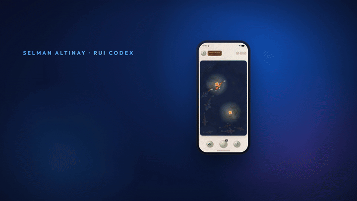
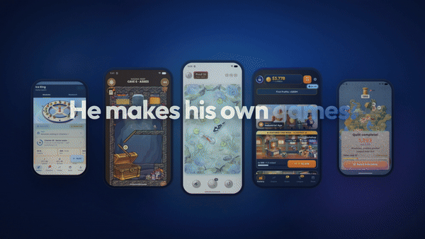
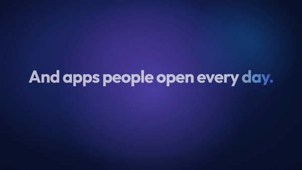
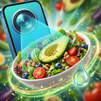
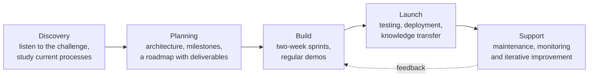
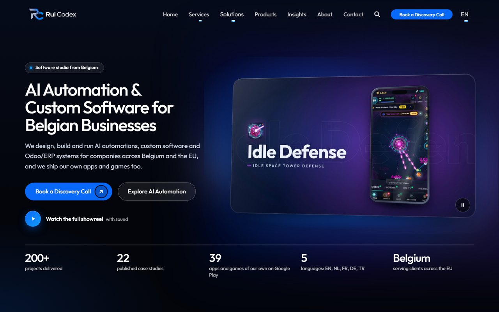
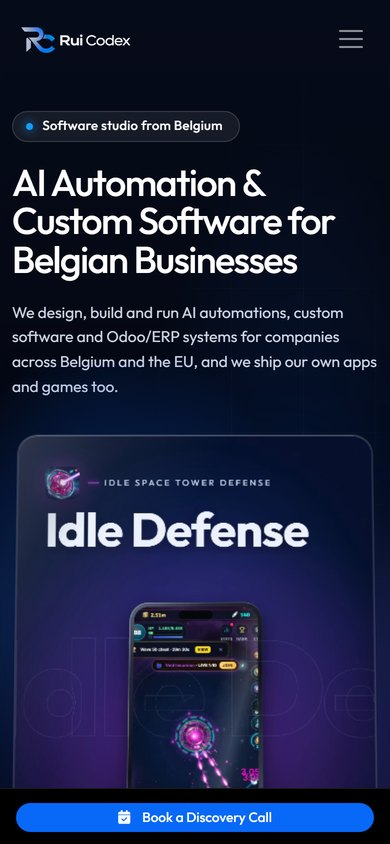
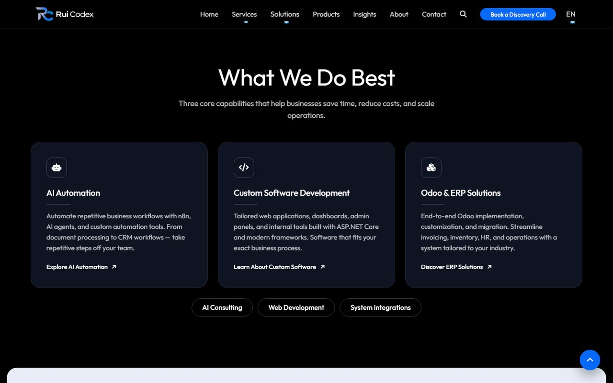

<div align="center">

<a href="https://ruicodex.com">
  <picture>
    <source media="(prefers-color-scheme: dark)" srcset="docs/media/banner.svg">
    
  </picture>
</a>

### I turn complex business problems into software that ships, and then I keep it running.

    <a href="https://play.google.com/store/apps/dev?id=6565660224420086428"></a>

**[ruicodex.com](https://ruicodex.com)** · **[LinkedIn](https://www.linkedin.com/in/selman-a-23ab38140/)** · **[Google Play](https://play.google.com/store/apps/dev?id=6565660224420086428)** · **[App Store](https://apps.apple.com/us/developer/selman-altinay/id1895496718)** · **[Watch the showreel](https://github.com/altinayselman/altinayselman/blob/main/docs/media/selman-altinay-showreel.mp4)**

</div>

<br>

<div align="center">

<a href="https://github.com/altinayselman/altinayselman/blob/main/docs/media/selman-altinay-showreel.mp4">
  
</a>

<sub><b>&#9654; Watch the 40-second showreel</b> (with sound): real screen recordings of the apps and games I build at Rui Codex, and ruicodex.com.</sub>

</div>

<br>

## About me

```javascript
const selman = {
  title:       "Full-Stack Software Engineer & CTO",
  company:     "Rui Codex, software engineering studio in Belgium",
  roles:       ["CTO @ MarQi Blinds", "Director @ Pointix", "Team Lead @ Payolog"],
  experience:  "12+ years · Hundreds of shipped projects",
  education:   ["Marmara Uni (CS)", "National Defence Uni (IE)", "Istanbul Uni (MIS)"],
  languages:   ["English", "Nederlands", "Türkçe"],
  superpower:  "Turning complex business problems into elegant, scalable software",
};
```

> *"I don't just write code. I engineer solutions that solve real problems and create measurable impact."*

<div align="center">
  
</div>

## What I build

<table>
  <tr>
    <td width="33%" valign="top">
      <h3>&#129513; Enterprise platforms</h3>
      Full-stack .NET and Node.js: admin panels, role-based access, dashboards.
    </td>
    <td width="33%" valign="top">
      <h3>&#129302; AI and automation</h3>
      n8n workflows, LLM agents and AI integration for smart content and decision systems.
    </td>
    <td width="33%" valign="top">
      <h3>&#128274; Secure API design</h3>
      REST and GraphQL with auth, rate limiting, CSP headers and encryption.
    </td>
  </tr>
  <tr>
    <td width="33%" valign="top">
      <h3>&#128202; Analytics and monitoring</h3>
      Real-time dashboards, KPI tracking, performance metrics and alerts.
    </td>
    <td width="33%" valign="top">
      <h3>&#127981; ERP and business systems</h3>
      Custom ERP from scratch and Odoo: HR, inventory and finance modules.
    </td>
    <td width="33%" valign="top">
      <h3>&#128241; Mobile apps and games</h3>
      Flutter and Unity, shipped to Google Play and the App Store with Rui Codex.
    </td>
  </tr>
</table>

## Apps and games I ship at Rui Codex

I founded **[Rui Codex](https://ruicodex.com)**, a software engineering studio in Belgium. Besides client work, we design, publish
and maintain our own titles: **39 apps and games on Google Play** at the latest count on our website.

<table>
  <tr>
    <td width="50%" align="center"><br><sub>Games: Koi Drift, Pull &amp; Plunder, Factory Legacy (real gameplay)</sub></td>
    <td width="50%" align="center"><br><sub>Apps: PixelCut Pro, EveryTranslate, Florea (real screen recordings)</sub></td>
  </tr>
</table>

<table>
  <tr>
    <td width="33%" valign="top">&nbsp;<b>Koi Drift</b><br>&nbsp;A calm koi pond puzzle<br>&nbsp;<a href="https://play.google.com/store/apps/details?id=com.ruicodex.koidrift">Google Play</a></td>
    <td width="33%" valign="top">&nbsp;<b>Pull &amp; Plunder</b><br>&nbsp;Pin-pull physics puzzles<br>&nbsp;<a href="https://play.google.com/store/apps/details?id=com.ruicodex.pullplunder">Google Play</a></td>
    <td width="33%" valign="top">&nbsp;<b>Factory Legacy: Idle Empire</b><br>&nbsp;Build your factory empire<br>&nbsp;<a href="https://play.google.com/store/apps/details?id=com.ruicodex.IdleFactoryTycoon">Google Play</a> · <a href="https://apps.apple.com/us/app/factory-legacy-idle-empire/id6777828643">App Store</a></td>
  </tr>
  <tr>
    <td valign="top">&nbsp;<b>PixelCut Pro</b><br>&nbsp;AI background remover<br>&nbsp;<a href="https://play.google.com/store/apps/details?id=com.ruicodex.pixelcut_pro">Google Play</a> · <a href="https://apps.apple.com/us/app/pixelcut-pro-ai-bg-remover/id6777847573">App Store</a></td>
    <td valign="top">&nbsp;<b>EveryTranslate</b><br>&nbsp;Text, documents and voice, many languages at once<br>&nbsp;<a href="https://play.google.com/store/apps/details?id=com.everytranslate.app">Google Play</a></td>
    <td valign="top">&nbsp;<b>Florea</b><br>&nbsp;Journal and planner<br>&nbsp;<a href="https://play.google.com/store/apps/details?id=com.ruicodex.florea">Google Play</a></td>
  </tr>
  <tr>
    <td valign="top">&nbsp;<b>Star Harbor</b><br>&nbsp;Build a space station that really works<br>&nbsp;<a href="https://play.google.com/store/apps/details?id=com.ruicodex.starharbor">Google Play</a></td>
    <td valign="top">&nbsp;<b>StandBy Clock</b><br>&nbsp;Bedside clock and photo display<br>&nbsp;<a href="https://play.google.com/store/apps/details?id=com.altinayselman.standbyclock">Google Play</a></td>
    <td valign="top">&nbsp;<b>Candy Chaos</b><br>&nbsp;Sort candies into matching boxes<br>&nbsp;<a href="https://play.google.com/store/apps/details?id=com.ruicodex.candychaos">Google Play</a> · <a href="https://apps.apple.com/us/app/candy-chaos-sweet-sort/id6779695174">App Store</a></td>
  </tr>
</table>

<details>
<summary><b>More titles</b> (Quiltvale, Lumen Loop, Ant Empire, Idle Defense and others)</summary>

<br>

<table>
  <tr>
    <td width="33%" valign="top">&nbsp;<b>Quiltvale</b><br>&nbsp;<a href="https://play.google.com/store/apps/details?id=com.ruicodex.quiltvale">Google Play</a></td>
    <td width="33%" valign="top">&nbsp;<b>Lumen Loop</b><br>&nbsp;<a href="https://play.google.com/store/apps/details?id=com.ruicodex.lumenloop">Google Play</a></td>
    <td width="33%" valign="top">&nbsp;<b>Ant Empire</b><br>&nbsp;<a href="https://play.google.com/store/apps/details?id=com.ruicodex.ant_empire">Google Play</a></td>
  </tr>
  <tr>
    <td valign="top">&nbsp;<b>Idle Defense: Cosmic TD</b><br>&nbsp;<a href="https://play.google.com/store/apps/details?id=com.ruicodex.idledefense">Google Play</a></td>
    <td valign="top">&nbsp;<b>Grandma's Kitchen</b><br>&nbsp;<a href="https://play.google.com/store/apps/details?id=com.ruicodex.grandmaskitchen">Google Play</a></td>
    <td valign="top">&nbsp;<b>Gravity Block Flip</b><br>&nbsp;<a href="https://play.google.com/store/apps/details?id=com.ruicodex.gravity_block_flip">Google Play</a></td>
  </tr>
  <tr>
    <td valign="top">&nbsp;<b>LetsLearn</b><br>&nbsp;<a href="https://play.google.com/store/apps/details?id=com.ruicodex.letslearn">Google Play</a></td>
    <td valign="top">&nbsp;<b>DietSem</b><br>&nbsp;<a href="https://play.google.com/store/apps/details?id=com.ruicodex.dietsem">Google Play</a></td>
    <td valign="top">&nbsp;<b>PosterBoost.ai</b><br>&nbsp;<a href="https://play.google.com/store/apps/details?id=com.ruicodex.posterboost.ai">Google Play</a></td>
  </tr>
</table>

<sub>The full catalogue is on the <a href="https://play.google.com/store/apps/dev?id=6565660224420086428">Google Play developer page</a>.</sub>

</details>

## Public builds

Hackathon and challenge projects built in the open with the Rui Codex team, plus a small personal project:

| Project | What it is |
|---|---|
| [**Hostwise**](https://github.com/RuiCodex-dev/hostwise) | An AI host that plans a dinner party for a group with different tastes, on Qloo's taste graph |
| [**Scopecast**](https://github.com/RuiCodex-dev/scopecast) | Monte-Carlo fixed-price quotes for freelance developers, with a confidence level you choose |
| [**Purser**](https://github.com/RuiCodex-dev/purser) | An AI treasurer for group events: PayPal Agent Toolkit and Gemini, with a mandate the agent can't break |
| [**Causeway**](https://github.com/RuiCodex-dev/open-agent-causeway) | An agent that explains why, with evidence |
| [**Invoice Airlock**](https://github.com/RuiCodex-dev/invoice-airlock) | Screens supplier emails with the Clocked API before they reach accounts payable |
| [**Hearthnote**](https://github.com/RuiCodex-dev/hearthnote) | A private notebook for families caring for someone at home, on NVIDIA Nemotron |
| [**WordRoom**](https://github.com/RuiCodex-dev/learn-ar-specs) | Learn Dutch de/het words on real-size kitchen objects, a Lens for Snap Specs |
| [**Emmy PTX**](https://github.com/RuiCodex-dev/emmy-ptx) | An Emmy kernel IR to NVIDIA PTX compiler |
| [**Nederlands-App**](https://github.com/altinayselman/Nederlands-App) | Browser mini-games for learning Dutch: match pictures, build sentences, listen and answer |

## How I work

The same five steps we use at Rui Codex, as described on [ruicodex.com](https://ruicodex.com):



## Tech arsenal

| Area | Tools |
|---|---|
| Languages | C#, TypeScript, JavaScript, Python, Java, SQL, HTML5, CSS3, Shell, Dart |
| Backend and frameworks | .NET 9 / ASP.NET Core, NestJS, Node.js, Express, SignalR, GraphQL, REST APIs |
| Frontend and UI | React, Next.js, Tailwind CSS, Bootstrap, jQuery, Chart.js, GSAP |
| Mobile and games | Flutter, Unity |
| Databases | PostgreSQL, SQL Server, MongoDB, MySQL, Redis, Prisma |
| DevOps and cloud | Azure, Docker, GitHub Actions, Nginx, Linux, Git |
| ERP | Odoo |
| AI and automation | OpenAI and Anthropic APIs, LLM agents, n8n |
| Tools | Postman, VS Code, Visual Studio, Cursor |

## Career journey

| Year | Role | Company | Focus |
|:----:|:-----|:--------|:------|
| **2024** | **Founder & CEO** | **Rui Codex** (Belgium) | Enterprise software, AI automation, apps and games for EU clients |
| **2023** | **Team Lead** | **Payolog** | FinTech solutions and architecture |
| **2022** | **CTO** | **MarQi Blinds** (US) | Smart blinds tech, scalable systems |
| **2022** | **Director** | **Pointix Bilisim** | Multi-industry software development |
| **2021** | **Sr. Developer** | **iXiredu** | E-learning platform (ASP.NET Core) |
| **2017** | **Full Stack Dev** | **Star Grup** | ERP, HR, inventory and cost systems |

<details>
<summary><b>Education and certifications</b></summary>

<br>

| University | Degree |
|:---|:---|
| **Marmara University** | Computer Software Engineering |
| **National Defence University** | Industrial Engineering |
| **Istanbul University** | Management Information Systems |

**Certifications**

- freeCodeCamp: Data Analysis with Python, Data Visualization, Machine Learning, Front End Libraries,
  JavaScript Algorithms, Responsive Web Design, Scientific Computing
- Microsoft: Software Developer
- ISO 27001: Information Security
- Google: SEO Optimization

</details>

## Let's work together

I'm always open to **new projects**, **consulting** and **collaborations**. The quickest route is the contact page on
[ruicodex.com/Contact](https://ruicodex.com/Contact), or [LinkedIn](https://www.linkedin.com/in/selman-a-23ab38140/).

<table>
  <tr>
    <td width="68%"></td>
    <td width="32%" rowspan="2" align="center"></td>
  </tr>
  <tr>
    <td></td>
  </tr>
  <tr>
    <td colspan="2" align="center"><sub>ruicodex.com, captured on desktop and phone.</sub></td>
  </tr>
</table>

<sub>Most of my work lives in private repositories under NDA. What you see here is a fraction of what I build every day.</sub>

<div align="center">

<br>

<picture>
  <source media="(prefers-color-scheme: dark)" srcset="https://raw.githubusercontent.com/altinayselman/altinayselman/output/github-snake-dark.svg">
  <source media="(prefers-color-scheme: light)" srcset="https://raw.githubusercontent.com/altinayselman/altinayselman/output/github-snake.svg">
  
</picture>

</div>

---

<sub>&copy; 2026 Selman Altinay. All rights reserved. Built by <a href="https://ruicodex.com">Rui Codex</a>.<br>
Media credits: every app and website screen in the showreel, GIFs and screenshots is a real capture of live Rui Codex apps and of ruicodex.com; app icons come from the live Google Play listings; no generated imagery is used on this page. Narration: Kokoro TTS (voice af_heart), rendered locally. Music and sound effects were synthesised in code. Video built with HyperFrames. The contribution snake is generated by this repo's own workflow (Platane/snk).</sub>
